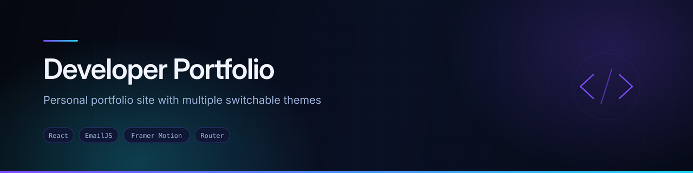
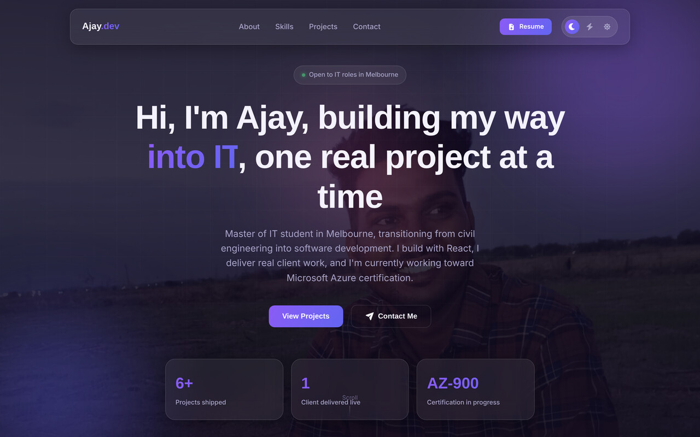

<div align="center">
  
</div>

<div align="center">


</div>

## Overview

My personal portfolio — a single-page React site covering who I am, what I work with, what I've built and how to reach me. Built from scratch rather than from a template, with a theme system and animated sections.

I'm a software developer in Melbourne moving from front-end work into cloud and network engineering, and this site is where that story and the projects behind it live.

## Preview



<sub>Screenshot captured from a local production build of this repository, shown in the default Indigo theme.</sub>

## Features

- **Three switchable themes** — Indigo (default), Neon and Light. The choice persists in `localStorage`, so the site reopens the way you left it.
- **Single-page scroll layout** — Hero, About, Skills, Projects and Contact, with navbar links scrolling to each section
- **Skills display grouped by category** with Font Awesome icons and proficiency bars, covering languages, frameworks, cloud and networking, and tooling
- **Project grid driven by data** — projects live in `src/AddOns/data/projects.js`, so adding one means editing a data file, not a component
- **Scroll-reveal animations** — a reusable `ScrollReveal` wrapper plus Framer Motion transitions
- **Working contact form** — messages arrive by email through EmailJS, no backend required
- **Responsive** across desktop, tablet and mobile

## Tech stack

| Layer | Technology |
|---|---|
| Framework | React (Create React App) |
| Animation | Framer Motion |
| Icons | Font Awesome (React component) |
| Theming | React Context + CSS custom properties, persisted to `localStorage` |
| Contact delivery | EmailJS |
| Styling | Hand-written CSS, one stylesheet per component |

## Project structure

```
src/
├── Components/
│   ├── Navbar/          Section navigation and theme toggle
│   ├── Hero/            Intro section
│   ├── About/           Background and story
│   ├── Skills/          Category-grouped skills with proficiency bars
│   ├── Projects/        Project grid
│   ├── Contact/         EmailJS contact form
│   ├── Footer/
│   └── Support_Tools/   ProjectCard, ScrollReveal, ThemeToggle
├── AddOns/
│   ├── context/
│   │   └── ThemeContext.jsx    Theme provider and useTheme hook
│   ├── data/
│   │   ├── projects.js         Project entries
│   │   └── skills.js           Skill categories
│   └── Assets/                 Images
└── App.js
```

## Running locally

```bash
git clone https://github.com/AJAY2043/my_portfolio.git
cd my_portfolio
npm install
npm start
```

The development server runs at `http://localhost:3000`.

```bash
npm run build     # production build into ./build
```

## Configuration

The contact form uses EmailJS, currently configured in `src/Components/Contact/Contact.jsx`. To run it against your own EmailJS account, move the values into a `.env` file at the project root:

```bash
REACT_APP_EMAILJS_SERVICE_ID=your_service_id
REACT_APP_EMAILJS_TEMPLATE_ID=your_template_id
REACT_APP_EMAILJS_PUBLIC_KEY=your_public_key
```

## Adding a project

Edit `src/AddOns/data/projects.js` and add an entry:

```js
{
  id: 'project-slug',
  title: 'Project name',
  subtitle: 'One-line framing',
  description: 'What it does and what you built.',
  image: projectImg,          // imported at the top of the file
  tags: ['React', 'Firebase'],
  links: { repo: 'https://github.com/…', live: 'https://…' },
  featured: false,
}
```

## Future improvements

- **Replace the placeholder project images.** Several entries currently reuse asset-pack photographs; these should be real screenshots of each project.
- Add a dedicated section for cloud and networking lab work (GNS3 topologies, Azure exercises) as that becomes the focus
- Move EmailJS configuration to environment variables
- Accessibility pass — focus states, reduced-motion support for the scroll animations, colour contrast across all three themes
- Add a downloadable résumé link

## Author

**Ajay Krishna Reddy Bhavanam** — Melbourne, Australia
[LinkedIn](https://linkedin.com/in/ajay-krishna-reddy) · [GitHub](https://github.com/AJAY2043)
